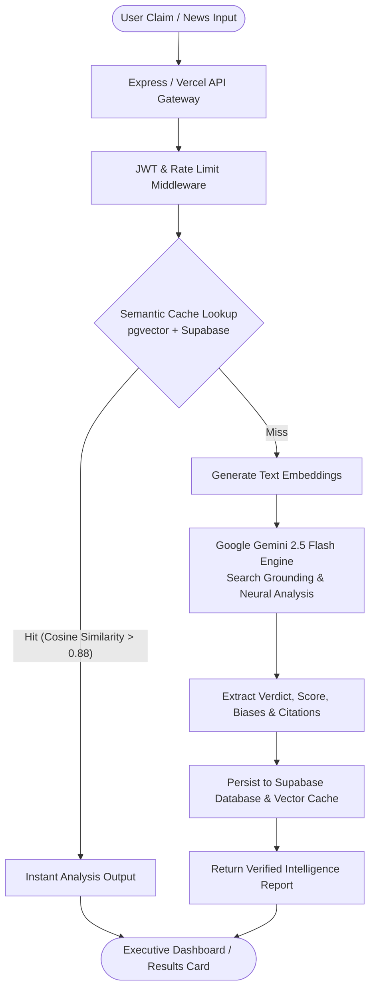

# 🛡️ SatyaKavach AI — Verified Intelligence & Misinformation Defense Engine

<p align="center">
  <strong>Next-Generation Multimodal AI Platform for Deep Misinformation Detection, Evidence Verification & Fact Checking</strong>
</p>

<p align="center">
  
  
  
  
  
  
  
</p>

---

## 📋 Overview

**SatyaKavach AI** (*सत्यकवच - The Shield of Truth*) is an enterprise-grade verified intelligence platform engineered to combat digital misinformation, sensationalism, and propaganda. Utilizing advanced neural language models and real-time news retrieval, SatyaKavach AI breaks down complex textual claims, cross-references statements against global knowledge nodes, identifies cognitive biases and logical fallacies, and delivers a rigorous **Credibility Index** accompanied by transparent, verifiable citations.

Equipped with an intelligent **Hybrid Semantic Caching Engine** powered by vector embeddings and Supabase PostgreSQL, SatyaKavach AI delivers sub-millisecond retrieval speeds for previously examined claims while drastically reducing API token overhead.

---

## ✨ Key Features

- 🧠 **Deep Grounded Neural Fact-Checking**:
  - Leverages **Google Gemini 2.5 Flash** with native search grounding.
  - Deconstructs intricate claims into isolated atomic statements for granular verification.
  - Cross-references real-time news nodes and scholarly references.
- 📊 **Multidimensional Credibility Analytics**:
  - **Verdict Classification**: Confirmed, Likely True, Mixed/Unverified, Misleading, or False.
  - **Credibility Score**: Dynamic confidence rating (0–100%).
  - **Fallacy & Bias Detection**: Identifies cognitive biases, emotional manipulation, false equivalencies, and strawman argumentation.
- ⚡ **Hybrid Semantic Caching Engine**:
  - Powered by **Supabase PostgreSQL** and **pgvector** embeddings (`embedding-001`).
  - Automatically identifies semantically equivalent claims and serves instant cached analyses.
  - Prevents redundant external API queries and maximizes system efficiency.
- 🔐 **Robust Authentication & Secure API Gateway**:
  - JWT token-based authentication with `bcryptjs` password hashing.
  - Server-side API proxy model: Sensitive credentials (`GEMINI_API_KEY`, `SUPABASE_SERVICE_ROLE_KEY`) are protected server-side and never exposed to the client.
- 🎨 **Executive Glassmorphism UI / UX**:
  - Built with React 19, TypeScript, and Vite.
  - Micro-interactions powered by `framer-motion` and data visualizations via `recharts`.
  - Real-time radar scanning animation overlays and interactive floating particle backdrops.
- 📜 **Historical Auditing & Bookmarking**:
  - Comprehensive history tracking with full audit trails.
  - Bookmark and tag critical investigations for executive reporting.
- ☁️ **Dual Runtime Deployment**:
  - Seamless support for **Vercel Serverless Functions** and **Express.js / Node.js** standalone environments.

---

## 🏗️ Architecture & Pipeline



---

## 📁 Repository Structure

```text
SATYAKAVACH-AI/
├── api/                          # Serverless & Express backend endpoints
│   ├── auth/                     # Authentication routes (login, signup, me, logout)
│   ├── debug/                    # Diagnostics & health checks
│   ├── lib/                      # Supabase server client & utilities
│   ├── middleware/               # JWT authentication middleware
│   ├── services/                 # Gemini API integration & prompt engineering
│   ├── utils/                    # Data formatting & sanitization helpers
│   ├── analyze.ts                # Core claim analysis orchestrator
│   └── history.ts                # Analysis history management endpoint
├── components/                   # Reusable React components
│   ├── Analyzer.tsx              # Analysis workflow controller
│   ├── AnalyzingOverlay.tsx      # Multi-stage radar scanning visualization
│   ├── DevHub.tsx                # Architecture & integration blueprint modal
│   ├── ErrorBoundary.tsx         # Component error boundary wrapper
│   ├── FloatingParticles.tsx     # Canvas particle physics backdrop
│   ├── HistoryPanel.tsx          # Historical investigations drawer
│   ├── InputForm.tsx             # Claim submission interface
│   ├── ProtectedRoute.tsx        # Auth route guard
│   ├── ResultsCard.tsx           # Comprehensive verdict & metric card
│   └── ResultView.tsx            # Full report analytics visualizer
├── contexts/
│   └── AuthContext.tsx           # Global user state & JWT token management
├── lib/
│   └── supabaseClient.ts         # Client-side Supabase connection
├── pages/
│   ├── HistoryView.tsx           # Audit log history view
│   ├── Home.tsx                  # Main verification workspace
│   ├── Landing.tsx               # Product overview & features landing page
│   ├── Login.tsx                 # Executive sign-in page
│   └── Signup.tsx                # New investigator registration
├── services/
│   ├── apiService.ts             # Typed REST API client
│   └── geminiService.ts          # Client proxy service
├── supabase/
│   └── migrations/
│       ├── 001_schema.sql        # Database schema, auth tables & RLS policies
│       └── 002_hybrid_cache.sql  # pgvector cache schema & similarity matching
├── App.tsx                       # Root router & application provider
├── index.html                    # Single Page Application entry HTML
├── server.ts                     # Local Express development server
├── server.js                     # Standalone production runner
├── setup_db.sql                  # Fast database setup script
├── types.ts                      # Shared TypeScript interface definitions
├── package.json                  # Dependencies & npm scripts
├── tsconfig.json                 # TypeScript compiler configuration
├── vite.config.ts                # Vite bundler configuration
└── README.md                     # Project documentation
```

---

## 🚀 Quick Start Guide

### 1. Prerequisites

Ensure you have the following installed on your system:
- [Node.js 18+](https://nodejs.org/)
- [npm](https://www.npmjs.com/) or [yarn](https://yarnpkg.com/)
- [Google Gemini API Key](https://aistudio.google.com/)
- [Supabase Account & Project](https://supabase.com/)

---

### 2. Clone the Repository

```bash
git clone https://github.com/arjun03125-art/SATYAKAVACH-AI.git
cd SATYAKAVACH-AI
```

---

### 3. Install Dependencies

```bash
npm install
```

---

### 4. Configure Environment Variables

Create a `.env` file in the root directory:

```env
# Google Gemini API Configuration
GEMINI_API_KEY=your_gemini_api_key_here

# Supabase Database Configuration
SUPABASE_URL=https://your-project.supabase.co
SUPABASE_SERVICE_ROLE_KEY=your_supabase_service_role_key
VITE_SUPABASE_URL=https://your-project.supabase.co
VITE_SUPABASE_ANON_KEY=your_supabase_anon_key

# Authentication & Server Settings
JWT_SECRET=your_super_secret_jwt_key
PORT=3000
```

---

### 5. Setup the Database

Execute the SQL migration scripts in your Supabase SQL Editor:
1. Run `supabase/migrations/001_schema.sql` to generate custom user accounts, analysis logs, and security policies.
2. Run `supabase/migrations/002_hybrid_cache.sql` to enable `pgvector` and initialize the semantic cache lookup tables.

---

### 6. Start the Development Server

To launch both the backend API and frontend Vite application concurrently:

```bash
npm run dev
```

- **Frontend Application**: `http://localhost:5173`
- **Backend API**: `http://localhost:3000`

Alternatively, you can run services individually:

```bash
# Frontend only
npm run dev:frontend

# Backend server only
npm run dev:backend
```

---

## 📡 REST API Reference

### 1. Analyze Claim
Evaluates a textual claim against Gemini neural models and search grounding.

- **Endpoint:** `/api/analyze`
- **Method:** `POST`
- **Headers:** `Content-Type: application/json`, `Authorization: Bearer <token>` *(optional)*

#### Request Body:
```json
{
  "text": "Breaking: Scientists have officially confirmed water on Mars.",
  "forceAI": false
}
```

#### Response Example:
```json
{
  "claim": "Scientists have officially confirmed water on Mars.",
  "verdict": "Likely True",
  "credibilityScore": 92,
  "summary": "NASA's Curiosity and Perseverance rovers alongside orbital spectroscopy have documented extensive evidence of sub-surface ice and historical water flows.",
  "biasesDetected": ["Sensationalist Headline Phrasing"],
  "fallacies": [],
  "evidence": [
    {
      "source": "NASA Jet Propulsion Laboratory",
      "url": "https://mars.nasa.gov",
      "snippet": "Orbital radars confirm vast reservoirs of water ice beneath the Martian surface."
    }
  ],
  "isCached": false
}
```

---

### 2. User Authentication

| Method | Endpoint | Description |
|---|---|---|
| `POST` | `/api/auth/signup` | Registers a new investigator account |
| `POST` | `/api/auth/login` | Authenticates user and returns JWT token |
| `GET` | `/api/auth/me` | Validates session token and returns active profile |
| `POST` | `/api/auth/logout` | Revokes local user session |

---

### 3. Investigation History

| Method | Endpoint | Description |
|---|---|---|
| `GET` | `/api/history` | Retrieves authenticated user's past claim verifications |

---

## 🔒 Security & Privacy Principles

- **Zero API Key Leakage**: Neither `GEMINI_API_KEY` nor `SUPABASE_SERVICE_ROLE_KEY` is accessible to the browser client; all requests are channeled through protected server-side routes.
- **Stateless Verification**: Unauthenticated users can verify claims without retaining private identity telemetry.
- **Cryptographic Password Storage**: User passwords are encrypted with `bcryptjs` utilizing adaptive salt rounds.

---

## 🤝 Contributing

Contributions, issues, and feature requests are welcome!

1. Fork the repository
2. Create your feature branch (`git checkout -b feature/NeuralModelUpgrade`)
3. Commit your changes (`git commit -m 'feat: Add multi-source consensus scoring'`)
4. Push to the branch (`git push origin feature/NeuralModelUpgrade`)
5. Open a Pull Request

---

## 📄 License

Distributed under the **MIT License**. See `LICENSE` for more information.

---

<p align="center">
  Developed by <a href="https://github.com/arjun03125-art"><strong>arjun03125-art</strong></a> • Defending Truth in the Age of Generative AI
</p>
